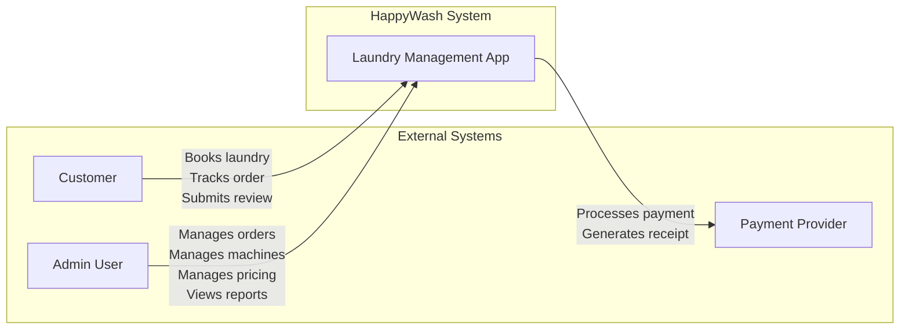
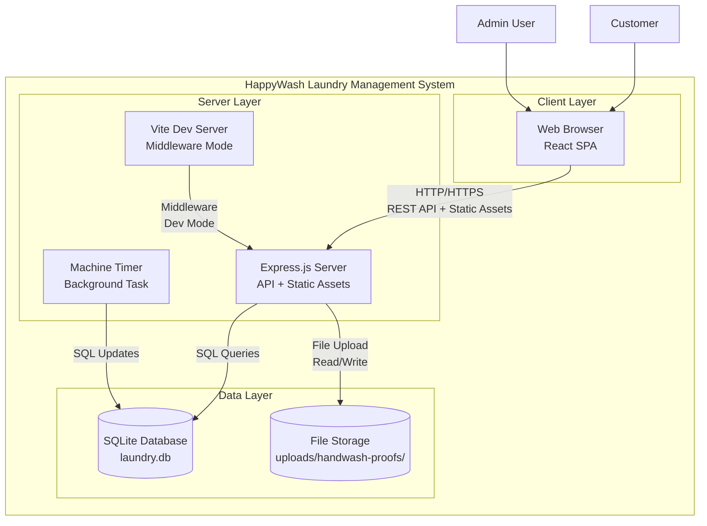
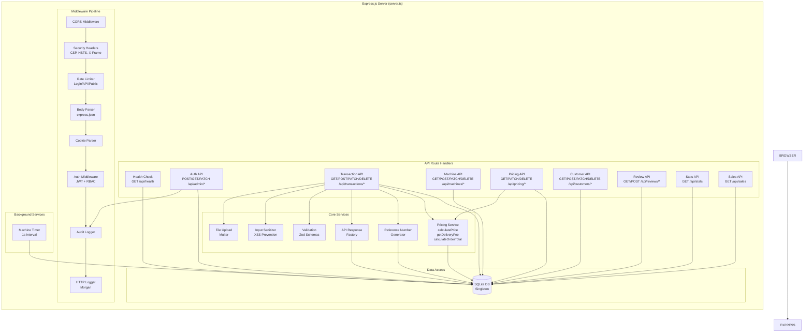
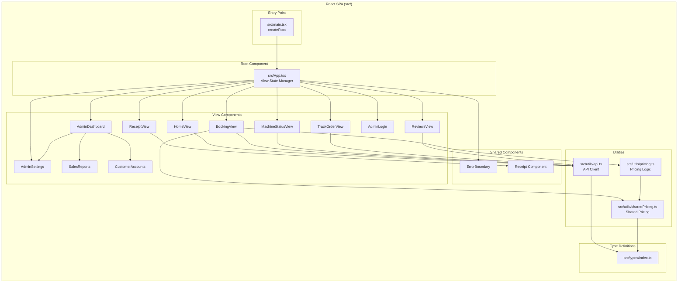
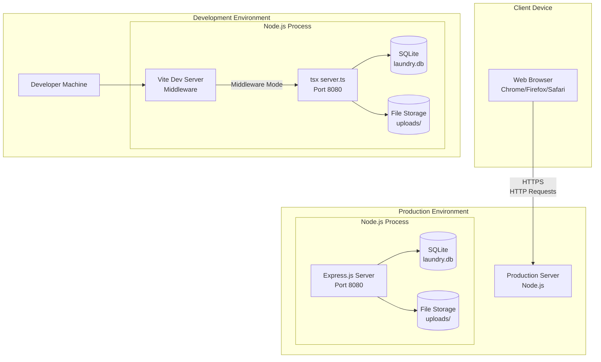
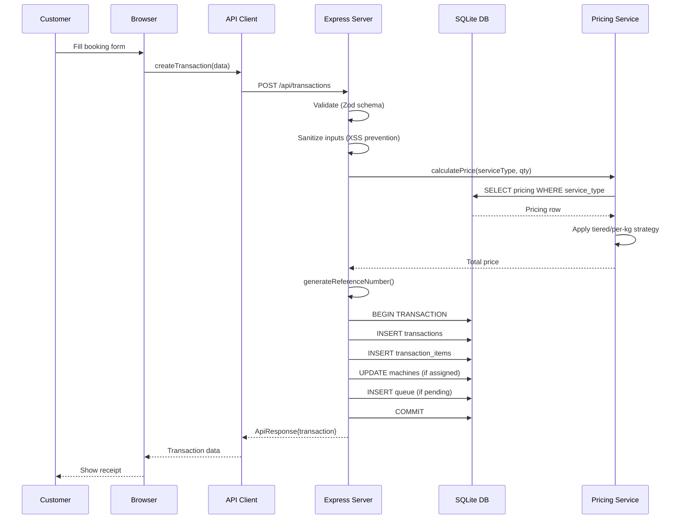
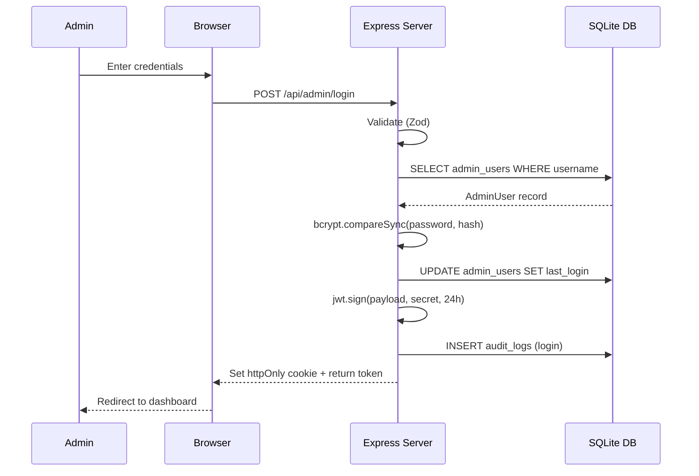
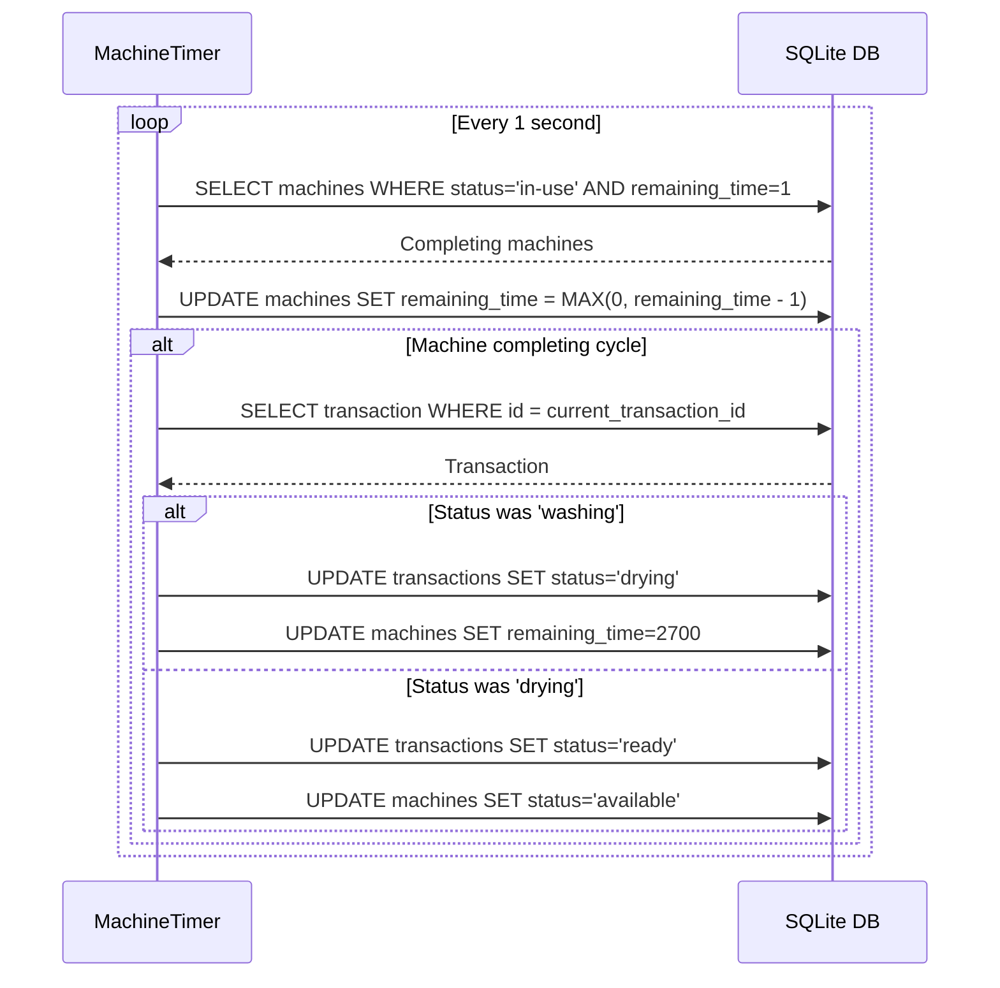
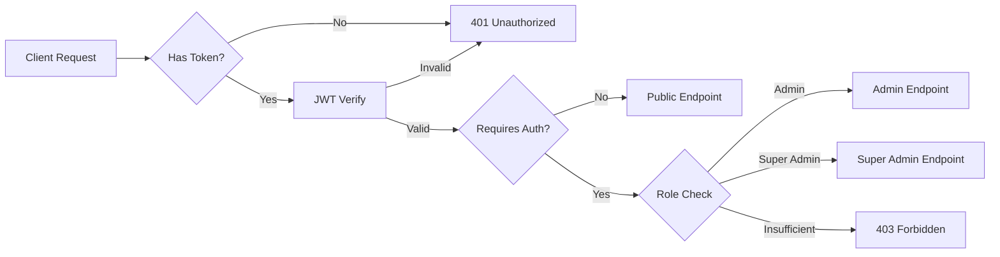

# System Architecture — HappyWash Laundry Management System

## 1. Architecture Overview

The HappyWash Laundry Management System follows a **monolithic full-stack architecture** with a unified TypeScript codebase. The backend (Express + Vite dev middleware) and frontend (React + Vite) are served from a single Node.js process in development, and the frontend is pre-built into static assets served by Express in production.

### 1.1 C4 Model — Context Level



### 1.2 C4 Model — Container Level



### 1.3 C4 Model — Component Level (Backend)



### 1.4 C4 Model — Component Level (Frontend)



---

## 2. Deployment Diagram



---

## 3. Data Flow

### 3.1 Transaction Creation Flow (Public Booking)



### 3.2 Admin Authentication Flow



### 3.3 Machine Timer Flow



---

## 4. Technology Stack

### 4.1 Backend

| Layer | Technology | Version |
|-------|-----------|---------|
| Runtime | Node.js | >= 18 |
| Framework | Express.js | 4.21.2 |
| Database | better-sqlite3 | 12.8.0 |
| Dev Server | Vite | 6.2.0 |
| TypeScript | tsx | 4.21.0 |
| Auth | jsonwebtoken | 9.0.2 |
| Password Hashing | bcryptjs | 2.4.3 |
| Validation | zod | 3.22.4 |
| File Upload | multer | 2.4.0 |
| Rate Limiting | express-rate-limit | 7.1.5 |
| HTTP Logging | morgan | 1.10.0 |
| Cookie Parsing | cookie-parser | 1.4.7 |
| UUID Generation | uuid | 9.0.1 |
| Environment | dotenv | 17.2.3 |

### 4.2 Frontend

| Layer | Technology | Version |
|-------|-----------|---------|
| Framework | React | 19.0.0 |
| Build Tool | Vite | 6.2.0 |
| Styling | Tailwind CSS | 4.1.14 |
| Icons | lucide-react | 0.546.0 |
| Animation | motion (Framer Motion) | 12.23.24 |
| Charts | recharts | 3.10.1 |
| QR Codes | qrcode.react | 4.2.0 |
| TypeScript | ~5.8.2 |

### 4.3 Testing

| Tool | Version |
|------|---------|
| Vitest | 1.3.1 |

### 4.4 Infrastructure

| Component | Technology |
|-----------|-----------|
| Database | SQLite (embedded) |
| File Storage | Local filesystem |
| Deployment | Single Node.js process |
| Environment | .env configuration |

---

## 5. API Endpoint Catalog

### 5.1 Authentication Endpoints

| Method | Path | Auth | Rate Limit | Description |
|--------|------|------|------------|-------------|
| POST | `/api/admin/login` | None | Login (5/15min) | Admin login with username/password |
| POST | `/api/admin/logout` | Required | API (500/min) | Logout and clear cookie |
| GET | `/api/admin/verify` | Required | API (500/min) | Verify JWT token validity |
| GET | `/api/admin/profile` | Required | API (500/min) | Get admin profile |
| PATCH | `/api/admin/profile` | Required | API (500/min) | Update admin username |
| PATCH | `/api/admin/change-password` | Required | Password (5/hr) | Change admin password |

### 5.2 Transaction Endpoints

| Method | Path | Auth | Rate Limit | Description |
|--------|------|------|------------|-------------|
| POST | `/api/transactions` | None | Public (30/15min) | Create new booking (public) |
| GET | `/api/transactions` | Required | API (500/min) | List all transactions (paginated) |
| GET | `/api/transactions/track/:reference` | None | Public (30/15min) | Track transaction by reference |
| PATCH | `/api/transactions/:id` | Required | API (500/min) | Update transaction (status, machine, etc.) |
| DELETE | `/api/transactions/:id` | Required | API (500/min) | Delete transaction (hard delete) |
| POST | `/api/transactions/:id/handwash-proof` | Required | API (500/min) | Upload handwash proof image |
| POST | `/api/admin/transactions` | Required | API (500/min) | Create walk-in order (admin) |

### 5.3 Machine Endpoints

| Method | Path | Auth | Rate Limit | Description |
|--------|------|------|------------|-------------|
| GET | `/api/machines` | None | None | Get all machines (public) |
| POST | `/api/machines` | Required | API (500/min) | Create new machine |
| PATCH | `/api/machines/:id` | Required | API (500/min) | Update machine status/time |
| DELETE | `/api/machines` | Required | API (500/min) | Delete all machines |
| DELETE | `/api/machines/:id` | Required | API (500/min) | Delete specific machine |
| POST | `/api/machines/reset` | Required | API (500/min) | Reset all machines to available |

### 5.4 Pricing Endpoints

| Method | Path | Auth | Rate Limit | Description |
|--------|------|------|------------|-------------|
| GET | `/api/pricing` | Required | API (500/min) | Get all active pricing |
| GET | `/api/pricing/public` | None | Public (30/15min) | Get public pricing (for booking form) |
| GET | `/api/pricing/history` | Required | API (500/min) | Get price change history |
| PATCH | `/api/pricing/:serviceType` | Required | API (500/min) | Update pricing for service type |
| DELETE | `/api/pricing/history` | Required | API (500/min) | Delete all price history |

### 5.5 Customer Endpoints

| Method | Path | Auth | Rate Limit | Description |
|--------|------|------|------------|-------------|
| GET | `/api/customers` | Required | API (500/min) | Get all customers (paginated) |
| POST | `/api/customers` | Required | API (500/min) | Create customer (no-op) |
| PATCH | `/api/customers/:phone` | Required | API (500/min) | Update customer info |
| DELETE | `/api/customers/:phone` | Required | API (500/min) | Soft delete customer |

### 5.6 Review Endpoints

| Method | Path | Auth | Rate Limit | Description |
|--------|------|------|------------|-------------|
| POST | `/api/reviews` | None | Public (30/15min) | Submit review (public) |
| GET | `/api/reviews` | Required | API (500/min) | Get all reviews (admin) |
| GET | `/api/reviews/public` | None | Public (30/15min) | Get public reviews |

### 5.7 Reporting Endpoints

| Method | Path | Auth | Rate Limit | Description |
|--------|------|------|------------|-------------|
| GET | `/api/stats` | Required | API (500/min) | Get dashboard stats |
| GET | `/api/sales` | Required | API (500/min) | Get sales report (with filters) |

### 5.8 Health Check

| Method | Path | Auth | Rate Limit | Description |
|--------|------|------|------------|-------------|
| GET | `/api/health` | None | None | Health check (DB connectivity) |

---

## 6. Database Schema

### 6.1 Entity Relationship Diagram

```mermaid
erDiagram
    TRANSACTIONS ||--o{ TRANSACTION_ITEMS : contains
    TRANSACTIONS ||--o{ REVIEWS : has
    TRANSACTIONS }o--|| MACHINES : assigned_to
    TRANSACTIONS ||--o{ QUEUE : queued_in
    PRICING ||--o{ PRICE_HISTORY : tracks
    ADMIN_USERS ||--o{ AUDIT_LOGS : generates

    TRANSACTIONS {
        int id PK
        string reference_number UK
        string customer_name
        string customer_phone
        string customer_email
        string service_type
        int quantity
        string special_instructions
        real weight
        string appointment_date
        string appointment_time
        string delivery_method
        string address
        string status
        real total_price
        real delivery_fee
        string payment_status
        string payment_method
        int machine_id FK
        string handwash_proof_image
        datetime created_at
        datetime updated_at
        datetime deleted_at
    }

    TRANSACTION_ITEMS {
        int id PK
        int transaction_id FK
        string service_type
        int quantity
        real unit_price
        real total_price
        datetime created_at
    }

    MACHINES {
        int id PK
        string name
        string type
        int capacity
        string status
        int remaining_time
        int avg_cycle_time
        int total_jobs_completed
        int is_default
        int current_transaction_id FK
    }

    REVIEWS {
        int id PK
        int transaction_id FK UK
        int rating
        string comment
        datetime created_at
    }

    QUEUE {
        int id PK
        int transaction_id FK
        int position
        int estimated_wait_time
        string estimated_start_time
        string estimated_end_time
        string status
        datetime created_at
    }

    PRICING {
        int id PK
        string service_type UK
        string pricing_type
        real base_price
        int tier_1_limit
        real tier_1_price
        int tier_2_limit
        real tier_2_price
        int tier_3_limit
        real tier_3_price
        int tier_4_limit
        real tier_4_price
        real tier_5_price_per_kg
        real per_kg_price
        int is_active
        real delivery_fee
        datetime updated_at
    }

    PRICE_HISTORY {
        int id PK
        string service_type
        string old_price_data
        string new_price_data
        string changed_by
        datetime created_at
    }

    ADMIN_USERS {
        int id PK
        string username UK
        string password_hash
        string role
        datetime last_login
        datetime created_at
        datetime updated_at
    }

    AUDIT_LOGS {
        int id PK
        int admin_id FK
        string action
        string details
        string ip_address
        string user_agent
        datetime created_at
    }
```

### 6.2 Indexes

| Table | Column(s) | Purpose |
|-------|-----------|---------|
| transactions | status | Filter by status |
| transactions | created_at | Sort by date |
| transactions | customer_phone | Lookup by customer |
| transactions | reference_number | Lookup by reference |
| transactions | machine_id | Join with machines |
| machines | status | Filter by availability |
| queue | status | Filter by queue status |
| queue | transaction_id | Join with transactions |
| queue | position | Sort by position |
| transaction_items | transaction_id | Join with transactions |
| price_history | service_type | Filter by service |
| price_history | created_at | Sort by date |
| audit_logs | admin_id | Filter by admin |
| audit_logs | action | Filter by action |
| audit_logs | created_at | Sort by date |

---

## 7. Security Architecture

### 7.1 Authentication & Authorization



**JWT Token Structure:**
```
Header: { alg: "HS256", typ: "JWT" }
Payload: { userId, username, type: "admin", role, exp: +24h }
```

**Token Storage:**
- **Cookie**: `admin_token` (httpOnly, secure in production, sameSite=strict)
- **Authorization Header**: `Bearer <token>` (alternative)

### 7.2 Security Layers

| Layer | Mechanism | Implementation |
|-------|-----------|----------------|
| Transport | HTTPS | HSTS header (`max-age=31536000`) |
| Authentication | JWT | `jsonwebtoken` with 24h expiry |
| Password Storage | bcrypt | `bcryptjs` with 10 salt rounds |
| Authorization | RBAC | `requireAuth`, `requireAdmin`, `requireSuperAdmin` |
| Rate Limiting | Token Bucket | `express-rate-limit` (3 limiters) |
| Input Validation | Schema | `zod` validation on all endpoints |
| XSS Prevention | Sanitization | `sanitizeInput()` strips HTML/JS |
| CSRF Protection | SameSite Cookies | `sameSite=strict` on auth cookie |
| Security Headers | CSP | Content-Security-Policy, X-Frame-Options, etc. |
| CORS | Whitelist | Origin-based allowlist |
| File Upload | Validation | MIME type check, 5MB size limit |

### 7.3 Security Headers

| Header | Value |
|--------|-------|
| Content-Security-Policy | `default-src 'self'; script-src 'self' 'unsafe-inline' https://cdn.tailwindcss.com; style-src 'self' 'unsafe-inline'; img-src 'self' data: https:; font-src 'self' https://fonts.gstatic.com; connect-src 'self' https:; frame-ancestors 'none'; base-uri 'self'; form-action 'self'` |
| X-Content-Type-Options | `nosniff` |
| X-Frame-Options | `DENY` |
| X-XSS-Protection | `1; mode=block` |
| Strict-Transport-Security | `max-age=31536000; includeSubDomains` |
| Cache-Control | `no-store` |
| Referrer-Policy | `strict-origin-when-cross-origin` |
| Permissions-Policy | `camera=(), microphone=(), geolocation=()` |

### 7.4 Rate Limiting Configuration

| Limiter | Window | Max Requests | Scope |
|---------|--------|-------------|-------|
| Login Rate Limiter | 15 minutes | 5 | `/api/admin/login` |
| Password Change Rate Limiter | 1 hour | 5 | `/api/admin/change-password` |
| API Rate Limiter | 1 minute | 500 | All authenticated endpoints |
| Public Rate Limiter | 15 minutes | 30 | Public endpoints |

---

## 8. System Architecture Rationale

### 8.1 Monolithic Architecture Choice

The system uses a **monolithic architecture** where the Express server serves both the API and the static frontend assets. This decision was driven by:

1. **Simplicity**: A single deployment unit reduces operational complexity. The entire application runs from one Node.js process (`server.ts:613-2575`).
2. **Shared State**: The SQLite database connection is a singleton (`server.ts:47`), and the machine timer runs in the same process, ensuring consistent state without distributed coordination.
3. **Development Efficiency**: Vite's middleware mode (`server.ts:617-622`) allows hot-reloading of frontend changes while the Express server handles API requests, providing a seamless development experience.
4. **Cost**: No need for separate infrastructure for frontend hosting, API gateway, or load balancers.

The trade-off is reduced scalability — the system cannot scale frontend and backend independently. However, for a single-location laundry service, this is an appropriate trade-off.

### 8.2 SQLite as Primary Database

SQLite was chosen over PostgreSQL/MySQL for several reasons:

1. **Embedded Nature**: No separate database server process is needed. The database is a single file (`laundry.db`), simplifying deployment and backup (`scripts/backup.ts`).
2. **ACID Compliance**: SQLite supports full ACID transactions, which are critical for the transaction creation flow where multiple tables must be updated atomically (`server.ts:1004-1113`).
3. **Performance**: For a single-location business with moderate traffic, SQLite's in-process execution is faster than network-based databases.
4. **Reliability**: SQLite is battle-tested and has a strong reputation for data integrity.

The `better-sqlite3` library is used instead of the standard `sqlite3` because it provides synchronous API access, which simplifies the Express route handlers and avoids callback complexity.

### 8.3 Unified TypeScript Codebase

The entire system — backend, frontend, and shared utilities — is written in TypeScript. The `sharedPricing.ts` module (`src/utils/sharedPricing.ts`) is imported by both the server (`server.ts:15`) and the frontend (`src/App.tsx:37`), ensuring that pricing calculations are consistent across both layers. This eliminates the common problem of pricing discrepancies between frontend display and backend billing.

### 8.4 Middleware Pipeline Architecture

The Express middleware pipeline is carefully ordered to ensure security and correctness:

1. **CORS** → **Security Headers** → **Rate Limiting** → **Body Parser** → **Cookie Parser** → **Auth** → **Audit Logging** → **HTTP Logging**

This ordering ensures that:
- CORS is checked first to reject unauthorized origins early
- Security headers are applied to all responses
- Rate limiting protects against abuse before expensive processing
- Body parsing happens after rate limiting to prevent DoS via large payloads
- Authentication is checked before any business logic executes
- Audit logging captures all authenticated actions
- HTTP logging captures the final request/response cycle

### 8.5 Background Task Integration

The machine timer (`server.ts:2472-2558`) runs as a `setInterval` within the same Node.js process. This design choice was made because:

1. **State Consistency**: The timer directly accesses the same SQLite database, ensuring that machine status updates are immediately visible to API requests.
2. **Simplicity**: No need for a separate worker process, message queue, or cron job.
3. **Atomicity**: The timer uses SQLite transactions (`db.transaction()`) to ensure that multi-table updates (machine status + transaction status) are atomic.

The trade-off is that the timer is tied to the server process lifecycle — if the server restarts, the timer resets. However, the timer's state is persisted in the database, so it resumes correctly.

### 8.6 Soft Delete Pattern

Transactions use a **soft delete** pattern (`deleted_at` column) rather than hard deletion. This is implemented in:

- **Schema**: `addColumnIfNotExists("transactions", "deleted_at", "DATETIME")` (`server.ts:121`)
- **Queries**: All transaction queries include `WHERE deleted_at IS NULL` (`server.ts:1484, 1531, 2127, 2183, etc.`)
- **Customer Deletion**: Soft-deleting a customer marks all their transactions as deleted (`server.ts:2388-2391`)

This pattern preserves audit trails and allows for data recovery, which is important for a business that needs to maintain financial records.

### 8.7 Hand Wash Special Handling

Hand wash orders have special business rules enforced at multiple layers:

1. **No Machine Assignment**: Hand wash orders cannot be assigned to machines (`server.ts:990-992`)
2. **Proof Image Required**: Before a hand wash order can enter the "washing" status, a proof image must be uploaded (`server.ts:1585-1590`)
3. **Image Upload Validation**: The handwash proof upload endpoint validates that the transaction is actually a hand wash order (`server.ts:1758-1762`)

This multi-layer enforcement ensures that business rules cannot be bypassed through API manipulation.

### 8.8 Multi-Item Transaction Support

The system supports transactions with multiple items of different service types. This is implemented through:

1. **Database**: The `transaction_items` table (`server.ts:179-190`) stores individual items
2. **Pricing**: Items are grouped by service type for tiered pricing calculation (`server.ts:1013-1027`)
3. **API**: The transaction schema accepts an `items` array (`server.ts:420-424`)
4. **Frontend**: The booking form supports adding multiple service types

This design allows customers to wash different types of items (e.g., clothes + comforters) in a single order, with pricing calculated correctly per service type.

### 8.9 Error Handling Strategy

The system uses a layered error handling approach:

1. **Zod Validation**: Input validation at the API boundary (`server.ts:400-440`)
2. **Global Error Handler**: Catches all unhandled errors and returns standardized responses (`server.ts:2408-2459`)
3. **Specific Error Types**: Handles Zod errors, SQLite constraint violations, and Multer upload errors separately
4. **Retry Logic**: Reference number collisions are retried up to 3 times (`server.ts:1000-1136`)

### 8.10 Frontend State Management

The frontend uses React's built-in `useState` and `useEffect` hooks for state management, avoiding the complexity of Redux or other state management libraries. The `View` type (`src/App.tsx:46`) controls which screen is displayed, and each view component manages its own local state. This approach is appropriate for a single-page application with moderate complexity.

The `ErrorBoundary` component (`src/components/ErrorBoundary.tsx`) catches React rendering errors and displays a fallback UI, preventing the entire application from crashing when a component fails.

### 8.11 File Upload Security

File uploads are secured through:

1. **MIME Type Validation**: Only image files are accepted (`server.ts:387-393`)
2. **Size Limit**: 5MB maximum file size (`server.ts:386`)
3. **UUID Filenames**: Uploaded files are renamed with UUIDs to prevent directory traversal attacks (`server.ts:378-380`)
4. **Authentication Required**: The upload endpoint requires admin authentication (`server.ts:1739`)
5. **Static File Protection**: Uploaded files are served through an authenticated route (`server.ts:634`)

### 8.12 Environment Configuration

The system uses environment variables for configuration (`server.ts:24-38`):

- `PORT`: Server port (default: 8080)
- `JWT_SECRET`: JWT signing key (required in production)
- `ADMIN_PASSWORD`: Initial admin password (required)
- `DB_NAME`: Database filename (default: laundry.db)
- `MACHINE_DEFAULT_TIME`: Default machine cycle time in seconds (default: 2700)
- `NODE_ENV`: Environment mode (development/production)

The JWT secret has a development fallback that generates a temporary UUID, with a warning logged to console (`server.ts:31-38`). In production, the secret must be explicitly set.

---

## 9. Performance Considerations

### 9.1 Database Query Optimization

- **Indexes**: Strategic indexes on frequently queried columns (`server.ts:99-106, 171-176, 193-195, 240-242, 271-275`)
- **Batch Queries**: Transaction items are fetched in a single query using `IN` clause to avoid N+1 problems (`server.ts:1512-1526`)
- **Pagination**: Transactions and customers are paginated with configurable page size (`server.ts:1477-1479, 2289-2292`)

### 9.2 Caching Strategy

- **Static Assets**: Frontend assets are served with `Cache-Control: no-store` for API responses and standard caching for static files
- **Pricing Data**: Pricing is fetched from the database on each request, but the shared pricing module provides fallback values for resilience
- **No Redis/Memcached**: The system does not use external caching, relying on SQLite's query cache and Vite's build-time optimizations

### 9.3 Background Task Efficiency

- **Single Interval**: The machine timer runs once per second, processing all in-use machines in a single database transaction
- **Batch Updates**: Machine time decrements are done in a single SQL UPDATE statement (`server.ts:2486-2490`)
- **Conditional Processing**: Only machines that are completing their cycle (remaining_time = 1) trigger additional database queries

---

## 10. Monitoring & Observability

### 10.1 Logging

| Logger | Purpose | Output |
|--------|---------|--------|
| Morgan | HTTP request logging | Console (short format) |
| Audit Logs | Admin action tracking | SQLite `audit_logs` table |
| Console | Application errors & events | Console |

### 10.2 Health Check

The `/api/health` endpoint (`server.ts:711-719`) checks database connectivity and returns a simple status response, suitable for load balancer health checks or monitoring tools.

### 10.3 Audit Trail

All admin actions are logged to the `audit_logs` table with:
- Admin ID
- Action type (login, logout, password_change, username_change, failed_login)
- Details (human-readable description)
- IP address
- User agent
- Timestamp

---

## 11. Deployment & Operations

### 11.1 Development

```bash
npm run dev
```
Runs `tsx server.ts` which starts both the Vite dev server (middleware mode) and the Express server on port 8080.

### 11.2 Production Build

```bash
npm run build
npm run preview
```
- `vite build` compiles the frontend into static assets in `dist/`
- The Express server serves these static files in production mode (`server.ts:682-686`)

### 11.3 Backup

```bash
npm run backup
```
Runs `scripts/backup.ts` which creates a timestamped backup of the SQLite database.

### 11.4 Environment Variables

Required environment variables (see `.env.example`):
- `ADMIN_PASSWORD` — Initial admin password (required)
- `JWT_SECRET` — JWT signing key (required in production)

Optional with defaults:
- `PORT` (default: 8080)
- `DB_NAME` (default: laundry.db)
- `MACHINE_DEFAULT_TIME` (default: 2700)
- `NODE_ENV` (default: development)
